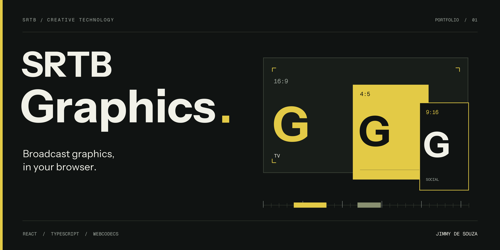
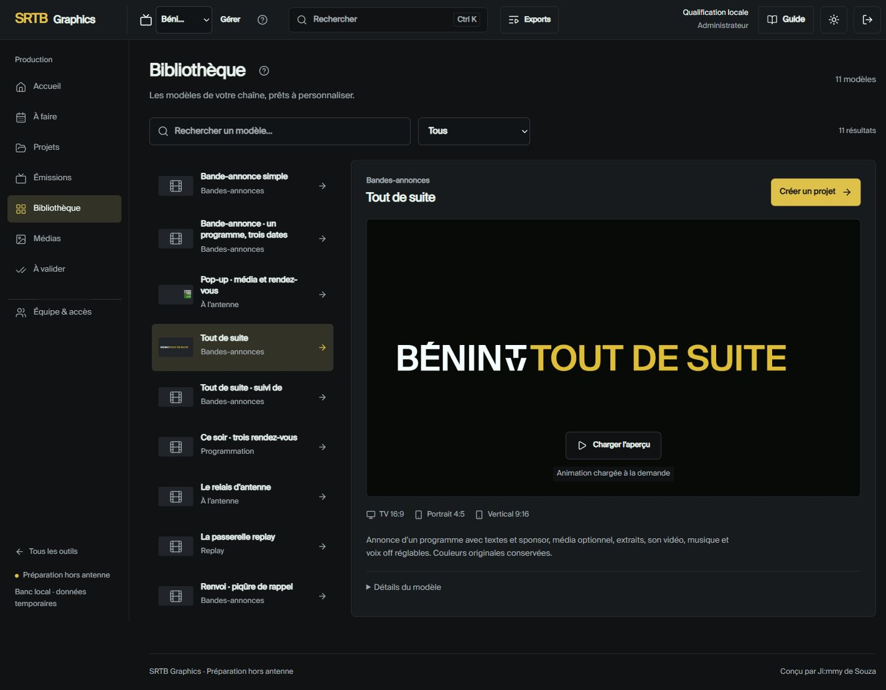
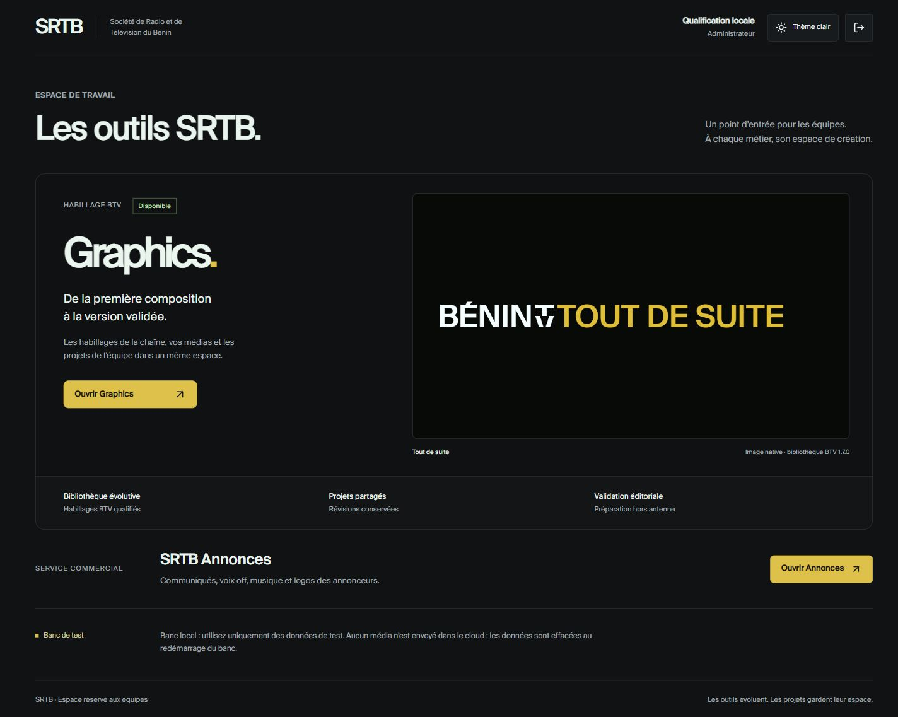
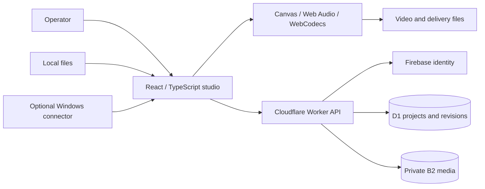

<p align="center">
  
</p>

<p align="center">
  <strong>English</strong> · <a href="README.fr.md">Français</a>
  <br />
  <a href="docs/PORTFOLIO.md">The story</a> · <a href="docs/ARCHITECTURE.md">Architecture</a> · <a href="docs/SETUP.md">Development</a> · <a href="docs/VERIFICATION.md">Verification</a>
</p>

<h1 align="center">From a programme brief to a reviewed video.</h1>

<p align="center">A shared workspace for broadcast graphics, production planning and audiovisual delivery.<br />Designed and developed by <a href="https://github.com/jimdsz"><strong>Jimmy de Souza</strong></a>.</p>

<br />



<p align="center"><sub>Actual application · Local demonstration data · French-language interface</sub></p>

<br />

<table>
  <tr>
    <td width="33%" valign="top"><h3>01 / Create</h3><p>Start with a broadcast template. Shape the text, graphics, media and audio with a live preview.</p></td>
    <td width="33%" valign="top"><h3>02 / Coordinate</h3><p>Connect programmes, tasks and media. Keep revisions and review responsibilities visible.</p></td>
    <td width="33%" valign="top"><h3>03 / Deliver</h3><p>Prepare TV and social formats. Export files with explicit progress, cancellation and checks.</p></td>
  </tr>
</table>

## The project

SRTB Graphics brings the preparation of television graphics into a shared browser workspace: choose a template, work with local media, edit a composition, review a revision, and produce a deliverable. It is designed around the day-to-day workflow of graphics operators and broadcast teams, with a French-language interface.

This repository presents the application source and its engineering decisions. **It is a public portfolio source snapshot, not a complete backup of the production installation or a ready-to-deploy public demo.** Licensed fonts, broadcast media, private configuration, data and installers are kept out of Git. See [setup and required assets](docs/SETUP.md).

## What it does

| Area | Capabilities implemented in the code |
| --- | --- |
| Graphics studio | Template catalogue, editable text, colours, logos, images, video excerpts and audio, with a live preview |
| Broadcast and social formats | TV 16:9, portrait 4:5 and vertical 9:16 compositions; linked variations and campaign preparation |
| Production planning | Spreadsheet/PDF conductor import, programme records, daily preparation, task assignment and media matching |
| Team workflow | Projects and revisions, comments, submission and approval, role-based access and conflict handling |
| Local media | Local file references and fingerprints, reconnection on another workstation, optional Windows connector |
| Exports | MP4/H.264, MOV/ProRes 4444, PNG sequences and WebM alpha paths; availability depends on the selected profile, browser and assets |
| Commercial announcements | A separate workspace for text sequences, logos, voice-over, music and video output |

The tool prepares files **off-air**. It does not send playout commands to a live broadcast system. Selecting a local file does not upload it automatically; cloud sharing is a separate action.

## Built for the production desk



Screenshots show the actual local application with a temporary qualification account and demonstration data. They are not mockups or production customer records.

## Engineering highlights

- **Client-side media processing:** rendering and encoding paths use Canvas, WebCodecs, Web Audio and workers, with progress and cancellation.
- **Preserved graphics engines:** versioned adapters and SHA-256 checks protect the original template library while supporting editing and preview.
- **Recoverable work:** revision checks, local drafts and navigation guards help prevent lost edits and accidental overwrites.
- **Explicit access control:** the backend validates identity, membership, roles and project access; a visible interface is not an authorization boundary.
- **Separate delivery profiles:** the native export profile and historical software fallback have different release requirements.



## Explore the source

```text
src/studio/             Studio, planning, team workflow and media tools
src/studio/video/       Rendering, timing, audio and export pipelines
src/studio/commercial/  Commercial announcements workspace
server/                Authentication, permissions, projects and storage API
migrations/            Database schema evolution
connector/             Optional local media connector and Windows packaging
scripts/               Asset preparation, build and release checks
tests/                 Unit, integration and browser qualification suites
docs/                  Portfolio, setup, architecture and verification notes
```

## Development

Use Node.js 24 LTS and npm. The portable checks below run without production credentials or the private graphics library:

```sh
npm ci
npm run typecheck
npm run test:portable
```

The complete studio needs the separately held graphics asset pack and local backend setup. Follow [SETUP.md](docs/SETUP.md) before running it. Restoring a deployment also requires independent backups of its D1 database and shared media.

## Verification status — 21 October 2026

The complete local installation successfully built with `build:studio:native:derivations`. A build defect involving hashed PDF `.mjs` assets was corrected and covered by two regression tests.

The broader review also found unresolved failures: **1,716 unit checks passed, 12 failed and 3 were skipped; 420 integration checks passed and 11 failed.** This repository does not claim a fully passing suite or broadcast certification. The [verification record](docs/VERIFICATION.md) explains the scope and outstanding work. CI covers the explicitly named portable subset only.

## About this portfolio entry

The project demonstrates product design for a specialised workflow, frontend and backend development, browser media engineering, and delivery tooling. It is presented as a working application with documented limitations; no unmeasured productivity or performance gains are claimed.

Author: [Jimmy de Souza](https://github.com/jimdsz). For the French presentation, read [README.fr.md](README.fr.md).

See [rights and third-party components](docs/RIGHTS.md) before reusing code, branding or media. No project-wide open-source licence is granted by this publication.
